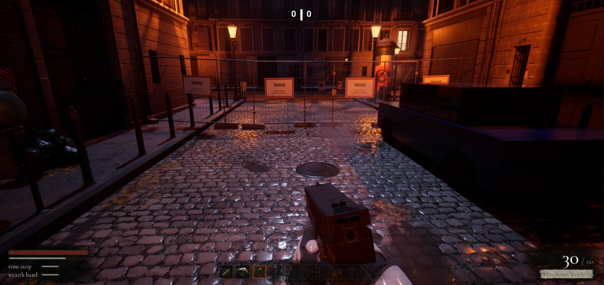
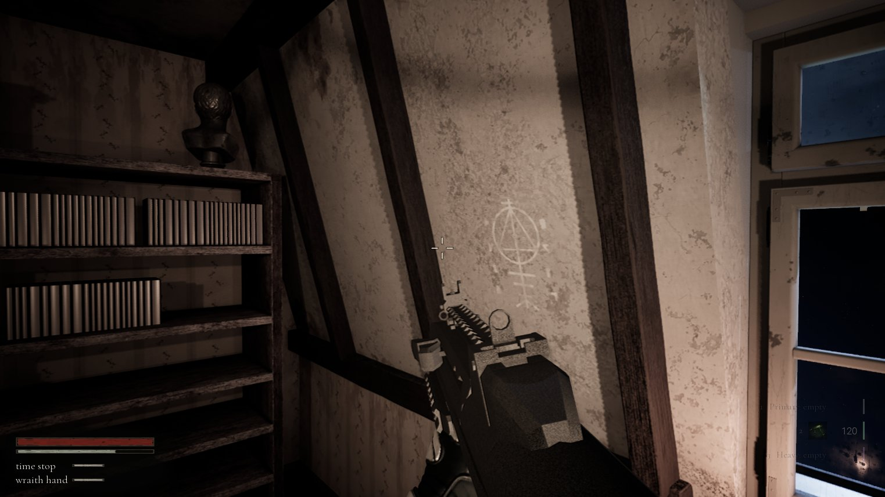
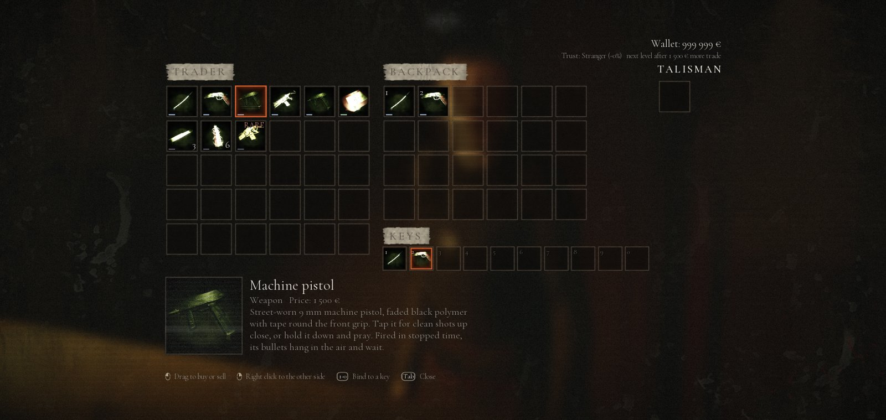
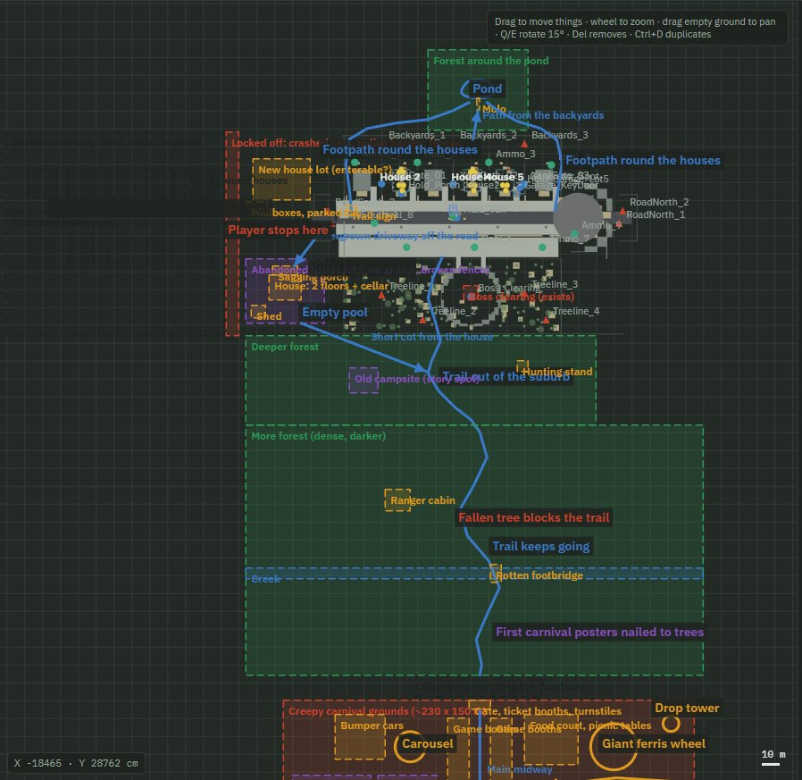
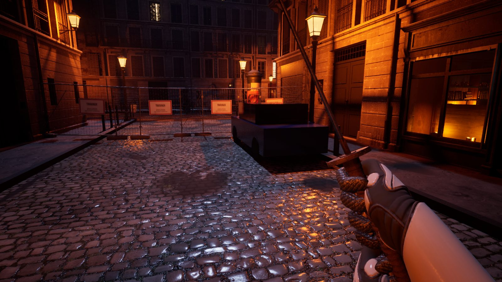
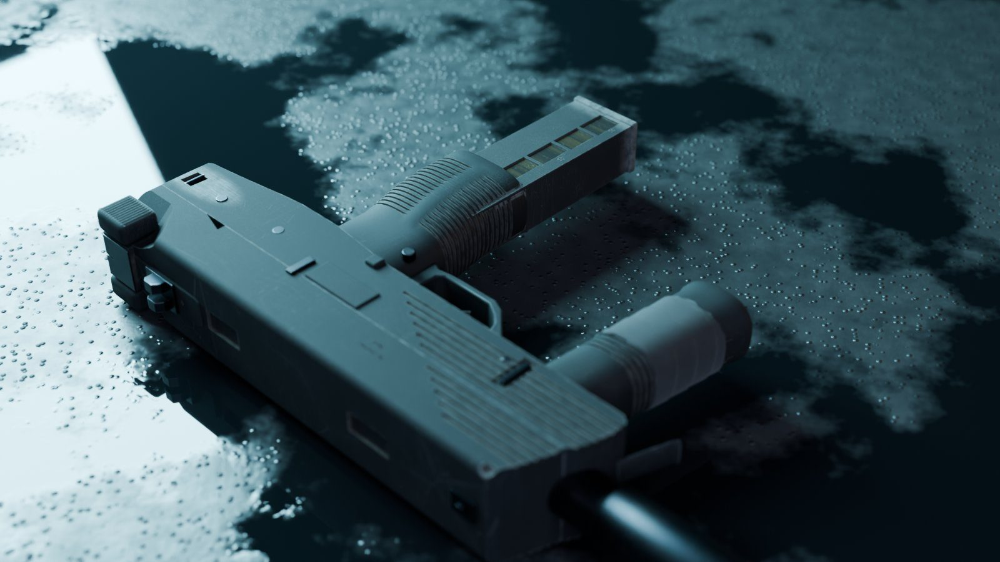

# Demon Hunter FPS

A first-person action shooter in **Unreal Engine 5**, built by a team of four. I'm the team lead and gameplay programmer.

**Live page:** https://mw002kk.github.io/demon-hunter-fps-showcase/

This repo is a showcase of the game: an overview, the systems I built, short code excerpts and screenshots.

## The game

Slow, deliberate combat in the spirit of Resident Evil 4, with a noir and gothic tone. The current build is a wave survival mode on a night street at the edge of a forest: four waves of creatures and a boss, short breaks to refill ammo and heal, and checkpoints that restart the current wave.

## Systems I built

| System | What it does | Tech |
|---|---|---|
| Time stop | Freezes incoming bullets mid-air; each one brakes on an exponential curve to a randomised stop point | GAS ability, C++ |
| Wraith's hand | A spectral hand grabs an enemy from up to 20 m, holds it and throws it for impact damage and knockdown | GAS ability, physics |
| Damage pipeline | Tagged hits (bullet, blade, holy, silver...) resolved by one execution: modifiers, crits, armour threshold, poise | GameplayEffect execution, attribute sets |
| Weapons and katana | Pistol and SMG with ammo types, wear and jams, recoil, procedural viewmodel; katana with path-cut attack | C++ |
| Enemy base and AI | Shared enemy class configured by data assets; ambient routines, noise and sight awareness, poise stuns, physics hit reactions | C++, StateTree |
| Wave survival | Data-driven waves, shuffled enemy mixes, spawn groups, refills, boss phase, checkpoints, dying lamps and thickening fog | C++ |
| Inventory and loot | Slot backpack and stash, stacking and swaps, hotbar, trader screen, body and container loot, corpse cap | C++, UMG |
| Dialogue | Data-driven branching dialogue with a face close-up and procedural head look-at | C++, Anim Instance |

## Code samples

Excerpts are on the [live page](https://mw002kk.github.io/demon-hunter-fps-showcase/#code):
damage resolution, bullet braking in the time stop, wave spawn bags and the corpse manager.

## Screenshots

| | |
|---|---|
|  |  |
|  |  |
|  |  |

More gameplay, level and weapon shots are on the [live page](https://mw002kk.github.io/demon-hunter-fps-showcase/).

## Stack

Unreal Engine 5 · C++ · Blueprints · Gameplay Ability System · StateTree · Enhanced Input · UMG · Niagara · Blender · Git LFS

---
Screenshots and renders © the team. All rights reserved.
